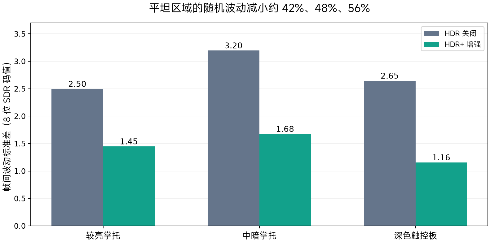
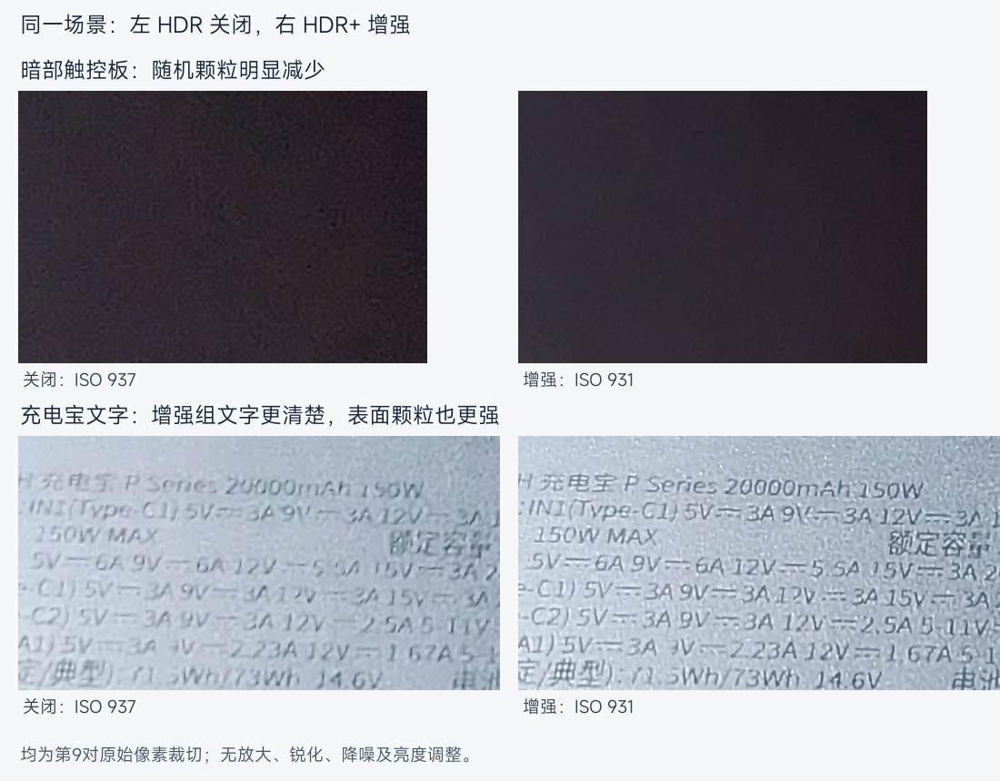

# October 31 static-scene quality comparison

User-labelled HDR-off and HDR-enhanced groups contained 10 JPEGs each, all 4000×3000, EXIF 1/20s, f/1.8 and sRGB. Primary analysis used pairs 3–10 to exclude initial ISO drift: off ISO929–945, enhanced ISO930–949. Mean full-image encoded brightness was 99.03 vs 98.96, so the observed flat-region improvement is not explained by a simple global brightening.

| Flat region | Off fluctuation | Enhanced fluctuation | Standard-deviation reduction |
|---|---:|---:|---:|
| Brighter laptop palm rest | 2.50 | 1.45 | 42.0% |
| Mid-dark palm rest | 3.20 | 1.68 | 47.6% |
| Dark touchpad | 2.65 | 1.16 | 56.3% |

Values are per-pixel, across-capture sample-variance RMS in 8-bit encoded sRGB luminance, after local alignment and subtracting frame brightness/linear-plane drift. Direct native-pixel crop checks without interpolation gave 41.9%, 47.6%, 56.6%. All-10 checks gave 42.2%, 47.0%, 56.2%. With no plane-drift correction the primary reductions were 35.0%, 41.4%, 52.4%. These are output fluctuation statistics, not sensor noise or overall image-quality percentages.

Text and cloth became more distinct, while the power bank surface showed stronger grain. High-frequency contrast mixes real detail, sharpening, noise and focus; it is not a resolution gain. Textured material was excluded from the pure-noise interpretation. A Haar-MAD estimate hit the 8-bit quantization floor and was rejected as a decision metric.

Limitations: no calibrated dynamic-range target, no per-frame logs/merge weights for this batch, no focus-lock evidence, no processing-time/total-attempt record, and only one static scene. Only the SDR primary JPEG was analyzed; gain-map HDR display rendering was not evaluated. The batch demonstrates a change associated with the whole enhanced configuration, not an isolated six-frame averaging contribution.

Original photos are not redistributed. Aggregate data and crops are included; the original files and detailed registration/native-pixel sensitivity scripts remain in the private research snapshot. A portable fixed-camera analysis tool and measurement instructions are available in the [general repository](https://github.com/ChenQian-0701/gcam-unisoc-research/blob/main/docs/quality.md). That simpler tool does not reproduce subpixel registration and must not be described as identical to the historical analysis.
